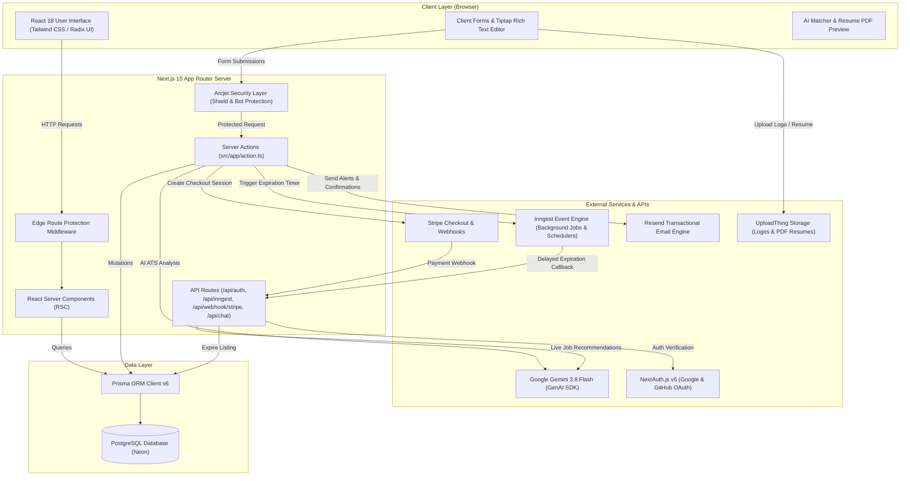
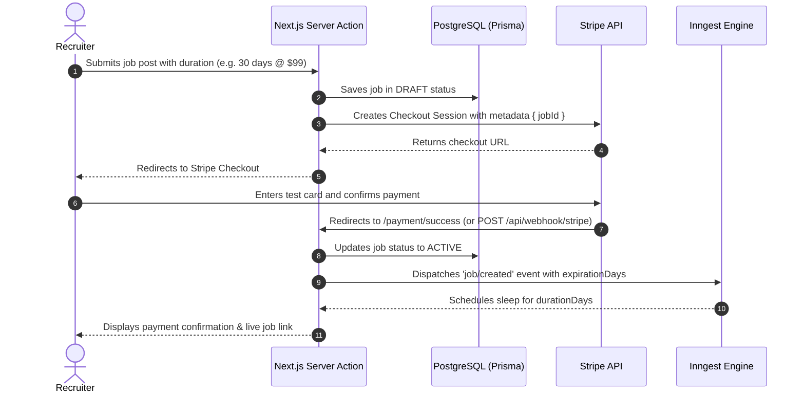
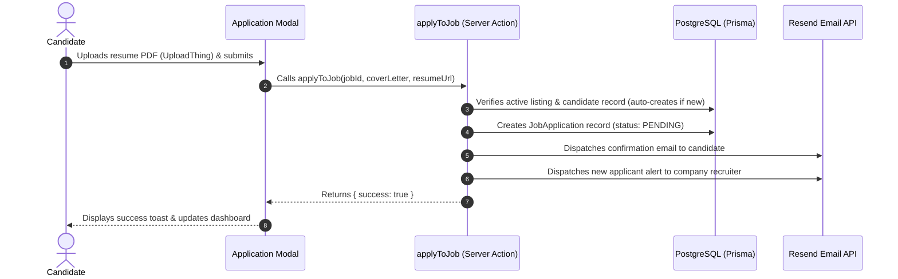

# Technical Architecture Document - Career Wave

## 1. High-Level Architecture Overview

Career Wave is designed as a modern, decoupled full-stack web application leveraging the **Next.js 15 App Router** architecture. It combines React Server Components (RSC) for high-performance rendering, Server Actions for type-safe data mutations, and specialized third-party services for AI evaluation, payment processing, background job scheduling, security shielding, file hosting, and database persistence.

### High-Level Architecture Diagram



---

## 2. Key Architecture Workflows

### 2.1 Stripe Checkout & Job Activation Flow



### 2.2 Application Submission & Transactional Email Flow



---

## 3. Technology Stack Breakdown

### 3.1 Core Framework & Runtime
- **Framework**: [Next.js 15.1.12](https://nextjs.org/) using React 18, React Server Components (RSC), and Server Actions.
- **Language**: TypeScript (v5) providing strict static typing across client and server boundaries.
- **Styling**: Tailwind CSS (v3), `tailwindcss-animate`, `@tailwindcss/typography`, and `clsx` / `tailwind-merge`.
- **UI Components**: Radix UI primitives (`@radix-ui/react-*`), Lucide Icons (`lucide-react`), Sonner toast notifications, and `next-themes`.

### 3.2 Artificial Intelligence
- **SDK**: Official `@google/genai` (v2.28.0).
- **Model**: `gemini-3.8-flash`.
- **Workflows**:
  - Chatbot with dynamic database injection for intelligent job matching.
  - Resume ATS analyzer returning structured JSON (score percentage, candidate strengths, and keyword gap recommendations).

### 3.3 Payments & Monetization
- **SDK**: `stripe` (v23+).
- **Integration**: Hosted Stripe Checkout Sessions supporting customized durations ($29 - $399).
- **Webhooks**: Endpoint `/api/webhook/stripe` verifying `checkout.session.completed` events.

### 3.4 Data Layer & Database
- **Database**: PostgreSQL (Neon Serverless).
- **ORM**: [Prisma ORM v6](https://www.prisma.io/) with `@auth/prisma-adapter`.
- **Integrity**: Cascading deletes (`onDelete: Cascade`) on company, seeker, application, and session relations.

### 3.5 Authentication & Authorization
- **Authentication**: NextAuth.js v5 (`next-auth@5.0.0-beta.25`) with Google OAuth and GitHub OAuth providers.
- **Edge Middleware**: Next.js route protection middleware ensuring unauthenticated requests cannot access recruiter or candidate portals.

### 3.6 Background Workflows & Email
- **Workflows**: [Inngest SDK](https://www.inngest.com/) (`inngest@^3.54.2`).
- **Handlers**: Automated job post expiration with cancellation support upon manual job deletion.
- **Transactional Email**: [Resend](https://resend.com/) delivering structured HTML notification templates for candidates and recruiters.

### 3.7 Security & Bot Shielding
- **Security SDK**: [Arcjet](https://arcjet.com/) (`@arcjet/next`).
- **Protections**: Rate limiting, request shielding, and bot detection across server actions and API routes.

---

## 4. Directory Structure

```
Career-wave/
├── prisma/
│   └── schema.prisma                 # Database models (User, Company, JobSeeker, JobPost, JobApplication, SavedJobPost)
├── public/                           # Static assets and brand logos
├── src/
│   ├── app/
│   │   ├── (mainLayout)/             # Core application layout and pages
│   │   │   ├── applications/         # Recruiter ATS candidate management & PDF preview
│   │   │   ├── company/[companyId]/  # Public company profile page
│   │   │   ├── favorites/            # Saved jobs dashboard for candidates
│   │   │   ├── job/[jobId]/          # Job details, apply modal & AI match analyzer
│   │   │   ├── jobs/                 # Browse all active jobs directory
│   │   │   ├── my-applications/      # Candidate tracking dashboard & withdrawal
│   │   │   ├── my-jobs/              # Recruiter dashboard with KPI analytics & draft checkout
│   │   │   ├── payment/              # Stripe checkout return pages (success & cancel)
│   │   │   ├── post-job/             # Job post creation with duration pricing
│   │   │   └── page.tsx              # Public landing page with search
│   │   ├── api/                      # Serverless API routes
│   │   │   ├── auth/[...nextauth]/   # NextAuth authentication handlers
│   │   │   ├── chat/                 # Gemini 3.8 Flash AI assistant route
│   │   │   ├── inngest/              # Inngest background event endpoint
│   │   │   ├── uploadthing/          # UploadThing file upload endpoint
│   │   │   └── webhook/stripe/       # Stripe checkout webhook handler
│   │   ├── action.ts                 # Type-safe Next.js Server Actions
│   │   ├── middleware.ts             # Route protection middleware
│   │   └── utils/                    # Shared utilities
│   │       ├── arcjet.ts             # Arcjet security configuration
│   │       ├── auth.ts               # NextAuth setup and helper exports
│   │       ├── db.ts                 # Prisma singleton instance
│   │       ├── email.ts              # Resend email templates & dispatcher
│   │       ├── stripe.ts             # Stripe singleton instance
│   │       └── zodSchemas.ts         # Zod schemas for form validation
│   ├── components/
│   │   ├── forms/                    # Form components
│   │   ├── general/                  # Shared UI components (AI Matcher, Table, Cards, PDF Preview)
│   │   ├── richTextEditor.tsx/       # Tiptap rich-text editor components
│   │   └── ui/                       # Radix UI primitives
│   └── lib/                          # Utility functions
└── package.json                      # Project dependencies & scripts
```
